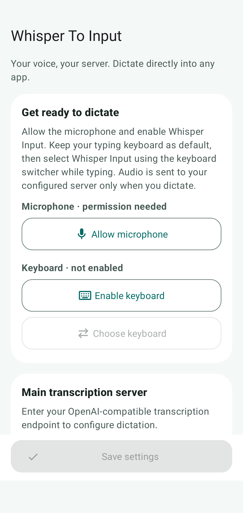
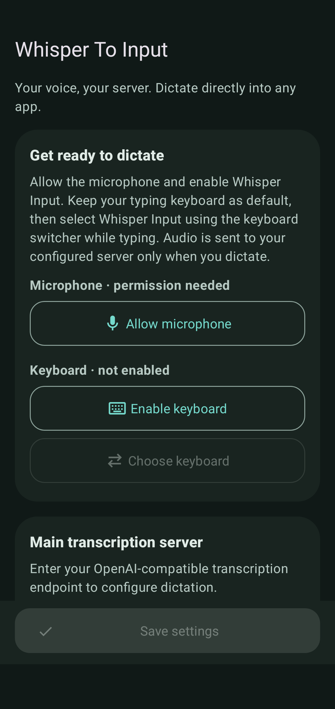
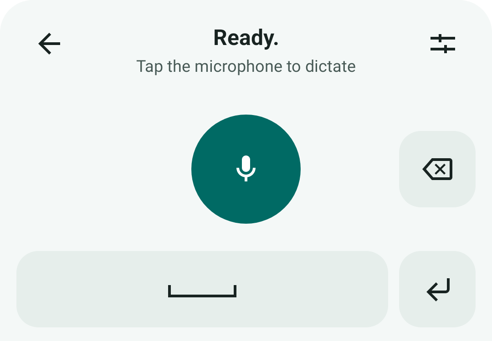
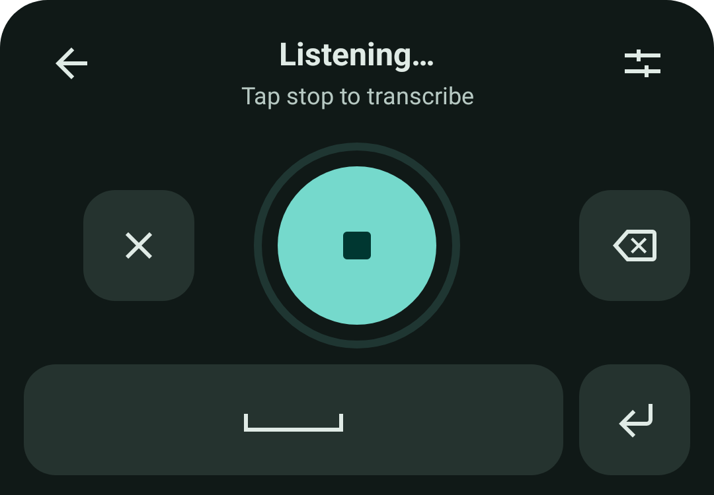
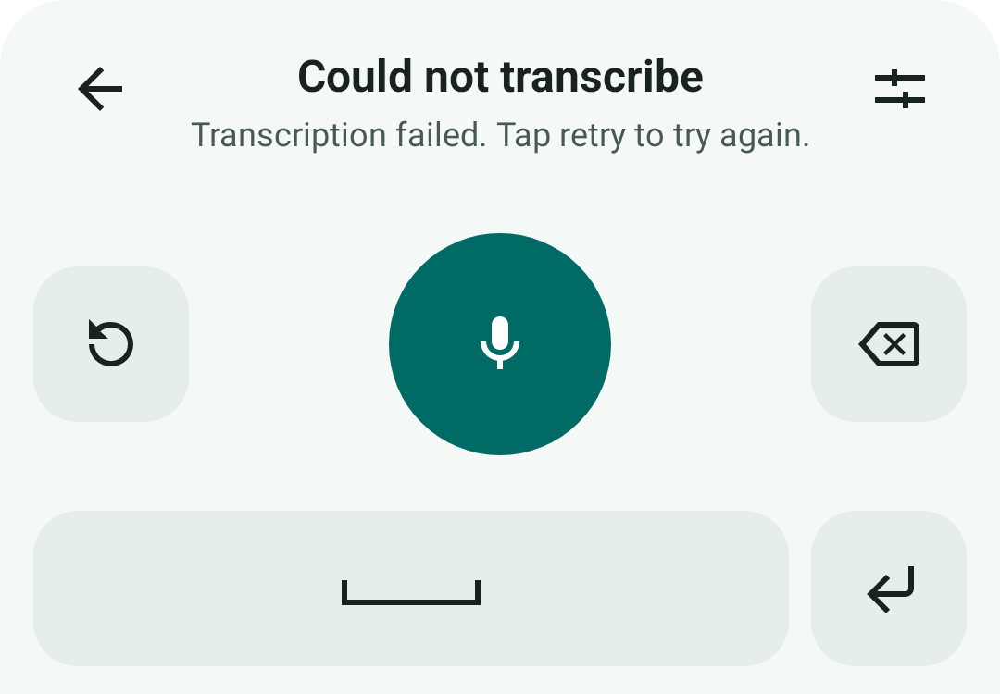
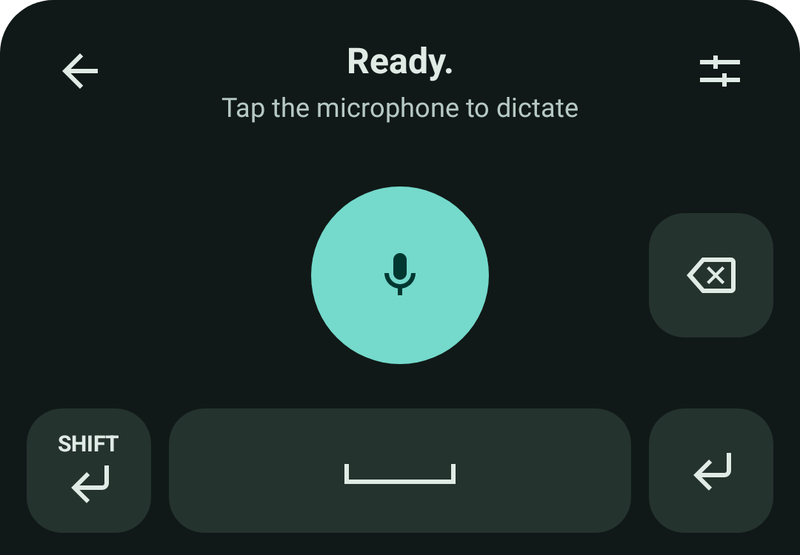

# Whisper To Input

**Your voice, your server. Dictate into Android apps with a Whisper-compatible transcription service.**

Whisper To Input is a compact voice keyboard for Android. Switch to it from your usual keyboard, speak, and insert the transcription into the active text field. Choose your own server, configure an optional fallback, and keep control over where your recordings go.

This is the maintained [jackthelobster fork](https://github.com/jackthelobster/whisper-to-input) of [j3soon/whisper-to-input](https://github.com/j3soon/whisper-to-input), with a redesigned interface, endpoint failover, and stronger credential and recording handling.

**[Download v0.6.0 APK](https://github.com/jackthelobster/whisper-to-input/releases/download/v0.6.0/whisper-to-input-v0.6.0.apk)** · [Release notes and checksums](https://github.com/jackthelobster/whisper-to-input/releases/tag/v0.6.0) · [Report an issue](https://github.com/jackthelobster/whisper-to-input/issues)

Requires **Android 7.0 or newer**, microphone permission, and a reachable OpenAI-compatible transcription server. Speech recognition runs on your configured server; no model is bundled with the app. Hosted services may require an account and charge for usage.

## A voice keyboard that fits your workflow

- **Dictate where you type.** Insert recognized speech directly into ordinary text fields, then return to your typing keyboard with the back arrow.
- **Bring your own server.** Set the full transcription URL, model, language, and optional API key. Use a hosted API or a compatible self-hosted service.
- **Keep a fallback ready.** Main and fallback servers have independent models, languages, and credentials. Availability checks prefer the main server and switch back when it recovers.
- **See what is happening.** Light and dark themes show connection status, listening, transcription, and retry controls.
- **Edit without switching.** Space, repeat-delete, Enter, and an optional Shift+Enter key sit alongside the microphone.
- **Tune the handoff.** Optionally record when the voice keyboard opens, add a trailing space, or return to the previous keyboard after transcription.

## Screenshots

<table>
  <tr>
    <th>Settings · light</th>
    <th>Settings · dark</th>
  </tr>
  <tr>
    <td></td>
    <td></td>
  </tr>
  <tr>
    <th>Ready to dictate</th>
    <th>Listening</th>
  </tr>
  <tr>
    <td></td>
    <td></td>
  </tr>
  <tr>
    <th>Retry a recording</th>
    <th>Optional Shift+Enter</th>
  </tr>
  <tr>
    <td></td>
    <td></td>
  </tr>
</table>

Captured on comet's Android 12 AOSP emulator at 1080 × 2280 pixels and 480 dpi. These are app views rendered by the instrumentation harness with dummy settings and simulated keyboard states. They do not show a live transcription session. [Capture details and all ten images](docs/images/v0.6.0/README.md).

## Install and start dictating

1. [Download the signed v0.6.0 APK](https://github.com/jackthelobster/whisper-to-input/releases/download/v0.6.0/whisper-to-input-v0.6.0.apk), open it on your Android device, and allow installation from that source if Android asks.
2. Open **Whisper To Input**. Use **Allow microphone**, then **Enable keyboard** to enable **Whisper Input** in Android's input settings.
3. Keep your usual typing keyboard as the default. Whisper Input is a temporary voice input selected while a text field is open.
4. Enter your main server's full transcription URL, model, language, and optional API key. New installations start with an empty URL and model. Use **Test connection**, then **Save settings**.
5. Open a text field in another app. With your typing keyboard visible, use Android's keyboard switcher to choose **Whisper Input**.
6. Tap the microphone, speak, then tap Stop. The app uploads the recording to the selected server and inserts the returned text. Tap the back arrow to resume typing.

On Samsung devices, keyboard settings are usually under **Settings → General management → Keyboard list and default**. Use the navigation bar's keyboard switcher; Samsung's microphone button may only offer Samsung or Google voice input.

The fork uses application ID `com.jackthelobster.whispertoinput` and can coexist with upstream. The v0.6.0 distribution APK uses this fork's existing release signing identity, allowing an update over its earlier signed release without uninstalling. Debug builds use a different key. If Android reports a signature conflict, check which build is installed before removing anything; uninstalling deletes app data.

## Connect a transcription server

The app sends an OpenAI-compatible multipart request with `file`, `model`, `response_format=json`, and `language` when supplied. It accepts JSON containing a `text` string or a plain-text transcription. Supported languages depend on your server and model; leave Language blank for detection when the server supports it.

| Setting | Hosted OpenAI example | Self-hosted Distil-Whisper example |
| --- | --- | --- |
| URL | `https://api.openai.com/v1/audio/transcriptions` | `https://your-server.example/v1/audio/transcriptions` |
| Model | `whisper-1` | `distil-whisper/distil-large-v3` |
| Language | `en`, or blank for detection | `en` (this model is English only) |
| API key | Your provider's API key | Your server's key, or blank if none is required |

These are configuration examples, not bundled services. Use the exact model ID and URL supplied by your provider. This fork implements the multipart transcription API; upstream's separate `/asr` backend mode, NIM-specific OGG mode, and Chinese text conversion options are not included.

For a private server that only supports HTTP, enable **Allow unsecure HTTP** explicitly and leave its API key empty. This setting applies to both main and fallback hosts. HTTP exposes audio and responses to the network; use HTTPS whenever possible, or a trusted private network/encrypted VPN. Keys are never sent over HTTP. A hostname must resolve from the Android device itself; `localhost` means the phone, not your server.

### Fallback and connection status

Enter a **Fallback transcription server** URL to enable fallback, or leave it empty to disable it. Configure its own model, language, and optional key.

While the voice keyboard is visible, automatic checks probe both servers concurrently and prefer a verified main, then a verified fallback, then an unverified main or fallback. A running upload stays on its original endpoint; these checks select the server for subsequent dictation rather than automatically replaying an upload.

| Status | Meaning and next step |
| --- | --- |
| **Ready.** | The server's model list includes your configured model. Tap the microphone. |
| **Ready. Using the fallback endpoint.** | The fallback is selected. Later checks keep trying the main server. |
| **Model unverified. Dictation available.** | Model discovery is unsupported, unreadable, or does not list the model. You can still attempt transcription. |
| **Endpoint(s) unavailable** | Check the URL, network, authentication, and server. Tap refresh to check again. |
| **Endpoint probe timeout** | No usable endpoint was found before timeout. Tap refresh to resume checks. |

Checks normally repeat every 30–60 seconds while an endpoint is usable. Unavailable checks retry at roughly 10, 20, and 40 seconds with jitter. Checks pause during recording, sending, and while audio is waiting to be resent. They resume after successful insertion or cancellation, and stop when the keyboard hides or the input session ends. **Test connection** checks the settings form without saving it. Neither model discovery nor a successful connection check uploads audio or proves transcription will succeed.

## Keyboard controls

| Control | What it does |
| --- | --- |
| Microphone / Stop / Resend | Start recording; stop and send it for transcription. After a failed send, resend the retained recording. When idle without a recording and endpoints are unavailable, refresh their status. |
| Cancel (X) | Discard the recording or cancel the active upload, return to idle, and resume endpoint checks. |
| Back arrow | Return to the previous keyboard; open the picker if Android has no previous keyboard. Leaving cancels unfinished dictation. |
| Settings | Open the app's configuration screen. |
| Backspace | Delete the selection or previous Unicode code point; hold to repeat. |
| Space | Insert a space; during recording, stop and transcribe with a trailing space. |
| Enter | Use the editor's action or insert a newline while idle. During recording, stop and transcribe with a newline without submitting the field. |
| Shift+Enter | Send Shift+Enter to the editor when enabled in settings; behavior depends on the receiving app. |

## Privacy and recording lifecycle

Audio goes to the endpoint you configure, whose own storage and privacy policies apply. Recording begins when you tap the microphone, or when the keyboard opens if you explicitly enable **Record when opened**; that option is off by default. Endpoint checks send no audio.

API keys are encrypted at rest using Android Keystore. Settings are protected by `FLAG_SECURE`, app backup is disabled, and HTTP redirects are refused. Dictation is disabled for password fields and fields that request no personalized learning; protection depends on the receiving app marking its fields correctly.

Recordings use a temporary private app file while the microphone is active and are limited to two minutes. After stopping, audio moves into RAM and the temporary file is deleted; uploads are capped at 25 MiB. Successful insertion releases the audio. Failed audio remains available to resend through the microphone button in the current session. Canceling, hiding the keyboard, or changing input sessions cancels work and removes retained audio. The app requires microphone and network access; it does not require notification or shared-storage permissions.

See the [security review](docs/SECURITY_REVIEW.md) for implementation details and review scope.

## Build and verification

This is a native Kotlin Android app, built with JDK 17, the checked-in Gradle 8.7 wrapper, Android Gradle Plugin 8.6.1, and SDK 35. Minimum SDK is 24. Run Gradle from `android/` with an installed Android SDK:

```sh
cd android
./gradlew --no-daemon testDebugUnitTest lintRelease assembleRelease assembleDebug assembleDebugAndroidTest
```

A signed release requires the existing distribution key through `ANDROID_KEYSTORE_PATH` and `ANDROID_KEYSTORE_PASSWORD`; without those variables the release output is unsigned. Never commit signing material. The release variant enables code minification and resource shrinking.

[Android verification](https://github.com/jackthelobster/whisper-to-input/actions/workflows/android.yml) runs on pull requests to `master` and manual dispatches, not pushes. Trusted manual dispatches produce signed distribution APKs and run the secret-backed OpenRouter authentication/model-discovery smoke check. The Android 12 CI emulator runs debug instrumentation. Unit tests cover endpoint selection, network policy, protocol parsing, cancellation, credential migration, audio ownership, and editor behavior.

See [AGENTS.md](AGENTS.md) for reproducible GitHub, comet, and native Termux build instructions. The release includes checksums, signature and manifest reports, source, and verification evidence. Emulator rendering and debug instrumentation do not establish physical-device acceptance or live microphone/server transcription behavior.

## License and credits

Licensed under [GPL-3.0-or-later](android/LICENSE). Release source is available from the matching Git tag and the source archive on the release page.

Based on [Whisper To Input by j3soon](https://github.com/j3soon/whisper-to-input). Original main contributors: Yan-Bin Diau ([@tigerpaws01](https://github.com/tigerpaws01)), Johnson Sun ([@j3soon](https://github.com/j3soon)), and Ying-Chou Sun ([@ijsun](https://github.com/ijsun)). See the [upstream contributors](https://github.com/j3soon/whisper-to-input/graphs/contributors) and [fork contributors](https://github.com/jackthelobster/whisper-to-input/graphs/contributors).
